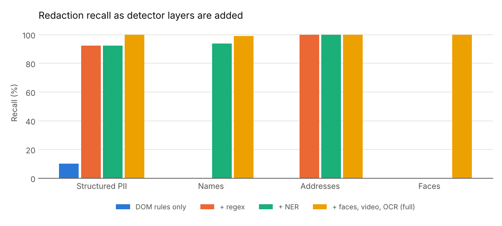
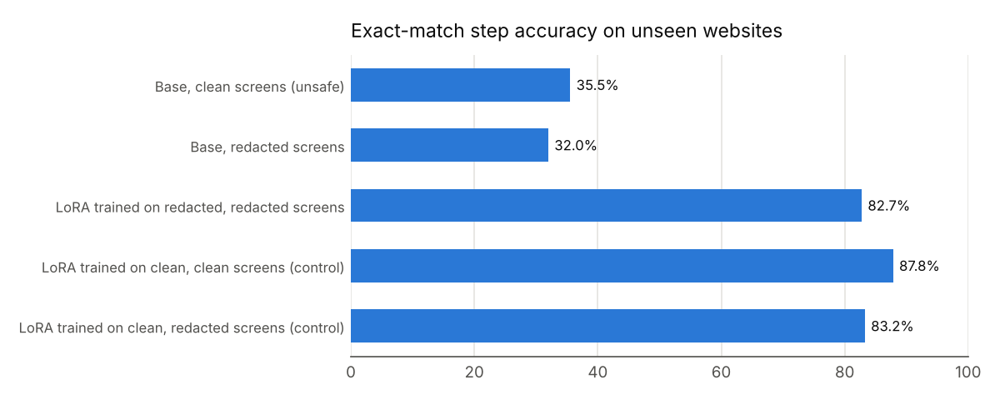

# PrivaSight: final results

The numbers below come from saved result files. The tables between the markers are regenerated by
`python eval/final_report.py`. Do not edit them by hand. Each result says which hardware and model produced it.
The project used only synthetic personas, and no real personal data was used anywhere.

## Summary

- **Privacy holds.** In 288 live agent runs with redaction (three models and serving setups), **0** runs leaked a personal value
  to the server. The unsafe clean-screens baselines leaked in 66 of 96 runs (Ollama) and 78 of 96 runs (Transformers). Across 225 captures
  of 15 pages, 0 ground-truth values appeared in an outgoing payload.
- **Redaction is accurate.** Text-PII recall is 99.7% (target ≥ 95%), structured PII is 100%, faces are 100% (target ≥ 95%) and
  precision is 94% (target ≥ 80%). The ablation shows that each detector layer is needed: DOM rules alone give 6.5%,
  adding regex gives 64.5%, adding NER gives 93.2%, and the full pipeline gives 99.7%.
- **It is fast enough.** Local redaction takes a median of 40 ms per step on WASM when the page text is cached. On a cache miss the
  Phase 5 median is 337 ms. Both are below the 500 ms target.
- **Redaction costs the untrained 2B model some task success; the LoRA adapter more than wins it back.** With the same weights and
  decoding (Transformers 4-bit, Kaggle T4), the base model completes 62.5% of tasks on clean screens and 46.9% on redacted screens. Its
  extra failures are mostly `ask_user` stops on fields that were hidden on purpose. With the LoRA adapter, success on redacted screens is
  **90.6%**: 100% on the three sites it was trained on and **80.0%** on the three sites it never saw, against 60.0% for the base model on
  those same sites. The earlier Ollama baseline showed no clear redaction cost (44.8% vs 38.5%); the two serving setups differ in
  quantisation and decoding, so compare conditions only within one setup.
- **What the fine-tune learned is not proven to be "redaction-awareness".** Offline, an adapter trained on clean screens was as good on
  redacted screens as the redacted-trained one (83.2% vs 82.7% step accuracy). The clean-trained adapter was not run live, so the live gain
  may also be mostly task learning.

## Definition of done (plan, Section 12)

| Item | Status | Evidence |
|---|---|---|
| Extension + server complete at least one multi-step task on every synthetic site | ✅ | Per-site success below (with the LoRA adapter: ≥ 66.7% on every site); demo video |
| Leakage 0 across the evaluation suite (server logs checked automatically) | ✅ | 0 of 288 redacted live runs; 0 in 225 captures; `run_all.py` passes |
| Redaction recall and precision per category, with layer ablation | ✅ | Tables below; ablation added in Phase 10 |
| Local latency for WebGPU and WASM | ✅ | Table below; Phase 5 log for cache-miss pages |
| Task success for clean, redacted base and redacted LoRA | ✅ | Measured live with one served model (`training/serve_hf.py` on a Kaggle T4): 62.5% / 46.9% / 90.6%, 0 leaks in both redacted conditions. Offline step accuracy too |
| README, ARCHITECTURE.md, DECISIONS.md, demo video | ✅ | `README.md`, `docs/`, `eval/reports/demo/privasight_demo.mp4` |

## Tables

<!-- tables:start -->
### Redaction recall and precision per category

Through the real extension on 225 captures (15 pages x 5 layouts x 3 personas, WASM backend, fine-tuned NER). Recall = ground-truth items whose box is >= 90% under painted regions; the pixel check confirms they are black (text, fields) or blurred (faces). Leaked = the value appears in the outgoing JSON.

| Category | Items | Recall | Painted (black/blurred) | Leaked |
|---|---|---|---|---|
| AADHAAR | 30 | 100.0% | 100.0% | 0 |
| ACCOUNT | 30 | 100.0% | 100.0% | 0 |
| CARD | 30 | 100.0% | 100.0% | 0 |
| CVV | 15 | 100.0% | 100.0% | 0 |
| DOB | 45 | 100.0% | 100.0% | 0 |
| EMAIL | 195 | 100.0% | 100.0% | 0 |
| IFSC | 30 | 100.0% | 100.0% | 0 |
| PAN | 30 | 100.0% | 100.0% | 0 |
| PHONE | 180 | 100.0% | 100.0% | 0 |
| ADDRESS | 60 | 100.0% | 100.0% | 0 |
| NAME | 285 | 98.9% | 98.9% | 0 |
| FACE | 90 | 100.0% | 100.0% | 0 |
| **All text PII** | 930 | **99.7%** |  | 0 |

Redaction precision (painted area on ground truth): **94.0%** (target >= 80%).

| Target (plan, Section 10) | Required | Measured |
|---|---|---|
| Fields and passwords | >= 98% | 100.0% (card/CVV fields; password fields: 100% in the Phase 2 and 9 checks) |
| Text PII | >= 95% | 99.7% |
| Faces | >= 95% | 100.0% |
| Precision | >= 80% | 94.0% |

### Local latency, WebGPU vs WASM

| Backend | Captures | Total ms (median / p95) | NER ms | Face ms | Paint ms | First capture ms (model load) |
|---|---|---|---|---|---|---|
| WASM (int8 NER, CPU face delegate) | 225 | 40 / 100 | 0 / 29 | 12 / 33 | 20 | 1509 |
| WebGPU (fp16 NER, GPU face delegate) | 90 | 93 / 222 | 0 / 121 | 18 / 60 | 30 | 4224 |

Total = ML + mapping + rules + painting per step, excluding the screenshot call and the first capture. These runs revisit the same pages, so most NER calls are cache hits (median 0 ms). Cache-miss pages (fresh names every step) were measured separately in Phase 5: median 337 ms, p95 about 600 ms on WASM (target: median < 500 ms). The WebGPU file is the Phase 5 run with the original NER model (90 captures); the fine-tuned model has no fp16 export, so WebGPU NER is not available for it.

### Layer ablation

Same 225 captures; each layer's painted regions are kept or dropped by their detector (the layers are independent and their regions are unioned, so dropping a layer's regions equals not running it). Leakage is not ablated: the leak guard and placeholder map run in every configuration.

| Layers | Structured PII | Names | Addresses | Faces | All text PII | Precision |
|---|---|---|---|---|---|---|
| DOM rules only | 10.3% | 0.0% | 0.0% | 0.0% | 6.5% | 100.0% |
| + regex | 92.3% | 0.0% | 100.0% | 0.0% | 64.5% | 99.9% |
| + NER | 92.3% | 93.7% | 100.0% | 0.0% | 93.2% | 98.1% |
| + faces, video, OCR (full) | 100.0% | 98.9% | 100.0% | 100.0% | 99.7% | 95.2% |

Reading: DOM rules alone catch only sensitive fields (card, CVV, password); regex adds almost all structured PII and every address; NER adds names; the full pipeline adds faces and the PII inside images and canvases (OCR: the HR ID card), which is why structured recall moves from 92% to 100% only at the last step. Each layer costs a little precision.

### Live task success, steps and leakage

32 tasks on the six sites, 3 runs each, Qwen3-VL-2B-Instruct. Two serving setups: **Ollama** on the laptop (Phase 6 baselines) and **Transformers 4-bit** on a Kaggle T4 behind a tunnel (`training/serve_hf.py`, Phase 10), where the base model and the LoRA adapter come from one loaded model, so those three conditions differ only in the adapter and the screens. Success = the site's final state matches the task (checked by its `/check` endpoint) within the step limit. Leak = any sensitive value of any persona, or a vault secret, in a request the server logged.

| Condition | Runs | Task success (mean ± std over 3 runs) | Steps / task | Runs with a leak |
|---|---|---|---|---|
| Qwen3-VL-2B, redacted (PrivaSight) | 96 | 44.8% ± 3.6 | 6.3 | 0 of 96 |
| Qwen3-VL-2B, clean screens (unsafe baseline) | 96 | 38.5% ± 1.8 | 5.9 | 66 of 96 |
| Qwen3-VL-2B base (HF 4-bit), clean screens (unsafe) | 96 | 62.5% ± 0.0 | 7.1 | 78 of 96 |
| Qwen3-VL-2B base (HF 4-bit), redacted (PrivaSight) | 96 | 46.9% ± 0.0 | 6.9 | 0 of 96 |
| Qwen3-VL-2B + redaction-aware LoRA (HF 4-bit), redacted (PrivaSight) | 96 | 90.6% ± 0.0 | 4.1 | 0 of 96 |

The Transformers server decodes greedily, so its three runs of a task are nearly identical (std 0): the effective sample is the 32 tasks, not 96 runs. A difference of one task is about 3 points.

| Site | Qwen3-VL-2B, redacted (PrivaSight) | Qwen3-VL-2B, clean screens (unsafe baseline) | Qwen3-VL-2B base (HF 4-bit), clean screens (unsafe) | Qwen3-VL-2B base (HF 4-bit), redacted (PrivaSight) | Qwen3-VL-2B + redaction-aware LoRA (HF 4-bit), redacted (PrivaSight) |
|---|---|---|---|---|---|
| DemoBank | 27.8% | 27.8% | 66.7% | 16.7% | 100.0% |
| HR Portal | 50.0% | 61.1% | 66.7% | 33.3% | 100.0% |
| Hospital | 60.0% | 40.0% | 40.0% | 60.0% | 100.0% |
| ShopMart | 66.7% | 50.0% | 50.0% | 66.7% | 66.7% |
| MailBox | 13.3% | 0.0% | 60.0% | 40.0% | 100.0% |
| VideoMeet | 50.0% | 50.0% | 100.0% | 75.0% | 75.0% |

Split by whether the LoRA adapter saw the site in training (the base-model rows show how hard each group is):

| Condition | Training sites (DemoBank, HR, Hospital) | Unseen sites (ShopMart, MailBox, VideoMeet) |
|---|---|---|
| Qwen3-VL-2B, redacted (PrivaSight) | 45.1% (23/51) | 44.4% (20/45) |
| Qwen3-VL-2B, clean screens (unsafe baseline) | 43.1% (22/51) | 33.3% (15/45) |
| Qwen3-VL-2B base (HF 4-bit), clean screens (unsafe) | 58.8% (30/51) | 66.7% (30/45) |
| Qwen3-VL-2B base (HF 4-bit), redacted (PrivaSight) | 35.3% (18/51) | 60.0% (27/45) |
| Qwen3-VL-2B + redaction-aware LoRA (HF 4-bit), redacted (PrivaSight) | 100.0% (51/51) | 80.0% (36/45) |

Every site has at least one task that the agent completes end to end with redaction on (definition of done, item 1). Per-task results, latency and failure reasons: `eval/reports/phase6/summary.md`.

### Fine-tuned VLM: offline step accuracy (Phase 7)

Qwen3-VL-2B-Instruct, QLoRA r16 on 499 samples (Kaggle T4). 197 held-out steps from websites never seen in training (ShopMart, MailBox, VideoMeet, 9 Mind2Web steps). Exact = same action type, element and value as the expert. One seed; the standard error of each cell is about 2.5 points.

| Model and screens | Steps | Valid JSON | Action type | Element | Exact match |
|---|---|---|---|---|---|
| Base, clean screens (unsafe) | 197 | 100.0% | 55.3% | 47.7% | **35.5%** |
| Base, redacted screens | 197 | 100.0% | 48.2% | 39.1% | **32.0%** |
| LoRA trained on redacted, redacted screens | 197 | 100.0% | 90.9% | 87.8% | **82.7%** |
| LoRA trained on clean, clean screens (control) | 197 | 100.0% | 96.5% | 93.4% | **87.8%** |
| LoRA trained on clean, redacted screens (control) | 197 | 100.0% | 94.4% | 89.8% | **83.2%** |

Reading: fine-tuning lifts exact match from about a third to about 83%, but a LoRA trained on clean screens does as well on redacted screens (83.2% vs 82.7%), so offline the gain is task learning, not redaction-awareness. Live, the same adapter lifts task success on redacted screens from 46.9% to 90.6% (table above); a live run of the clean-trained adapter was not done, so the live result cannot separate the two either.

### Indian-name NER (Phase 8)

Person entities on held-out synthetic UI text (names and templates unseen in training), a hand-written list of harder names, and rows with no names (false person tags).

| Set | F1, shipped model | F1, fine-tuned | Word recall / false tags, shipped | fine-tuned |
|---|---|---|---|---|
| Held-out names (n=1500) | 87.4% | 98.5% | 86.8% | 99.9% |
| Hand-written hard names (n=1200) | 97.2% | 97.0% | 98.0% | 100.0% |
| Rows with no names (n=1200): false person tags |  |  | 3.1% | 1.5% |

In the browser the fine-tune did not change name recall (98.9% before and after: the Phase 5 heuristics already recovered the persona names); the int8 model matches PyTorch and has the same size (108 MB).
<!-- tables:end -->

## Not done, stated plainly

- **A live run of the clean-trained adapter** (the control that would show whether the live gain is redaction-awareness or task learning).
  It needs the clean adapter from Phase 7 served by `serve_hf.py` and one more `run_eval.py` condition.
- **Qwen3-VL-4B/8B and GUI-Owl-1.5 baselines.** These were not run because the models do not fit the 4 GB laptop GPU. They are defined in `eval/conditions.yaml`.
- **Task success per ablation layer.** Recall is ablated, but task success is not, because that needs a separate build per layer and about 3 hours of model time each.
- **Offline grounding on ScreenSpot and the Mind2Web test split.** This was not run. Only 9 Mind2Web steps are in the held-out set.
- **NER int8 vs fp32 in the browser, and 2B/4B/8B server runtimes.** These were not measured. NER fp16 on WebGPU was measured with the Phase 5 model only.
- **Firefox.** It was not attempted (see `FIREFOX.md`).

## Where each number comes from

| Result | File | Produced by | Hardware |
|---|---|---|---|
| Recall, precision, leakage per category | `eval/reports/phase5_wasm.json` | `phase5_eval.mjs 3 ",dark,serif,large,shift" wasm` | development laptop (RTX 3050 4 GB) |
| WebGPU latency | `eval/reports/phase5_webgpu.json` | same, `webgpu` | development laptop |
| Layer ablation | `eval/reports/phase10_ablation_wasm.json` (+ `.log`) | `OUT=reports/phase10_ablation_wasm.json node phase5_eval.mjs 3 ",dark,serif,large,shift" wasm` | Linux container, 2 CPUs, software GL. Its recall and precision match the laptop run, and its latency is not used |
| Live task success, leakage (Ollama) | `eval/results/qwen3vl-2b-{redacted,clean}.jsonl`, `eval/reports/phase6/` | `run_eval.py` | development laptop, Ollama |
| Live task success, leakage (base vs LoRA) | `eval/results/qwen3vl-2b-{hf-clean,hf-redacted,lora-redacted}.jsonl` | `run_eval.py` with `serve_hf.py` | laptop browser + Kaggle T4 (Transformers 4-bit, greedy) |
| Offline step accuracy | `training/results/res_*.json` | `eval_hf.py` | Kaggle T4 |
| NER F1 | `training/results/ner_eval_*.json` | `train_ner.py` | laptop CPU |
| Demo | `eval/reports/demo/` | `record_demo.mjs` with the scripted expert | Linux container |
