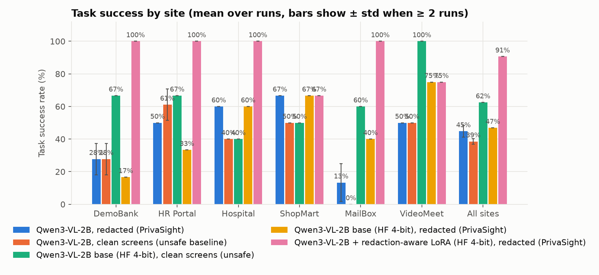
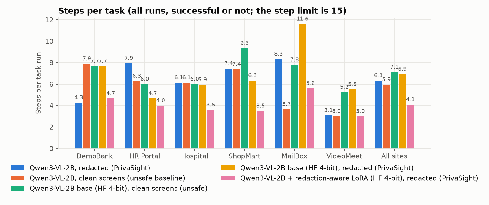
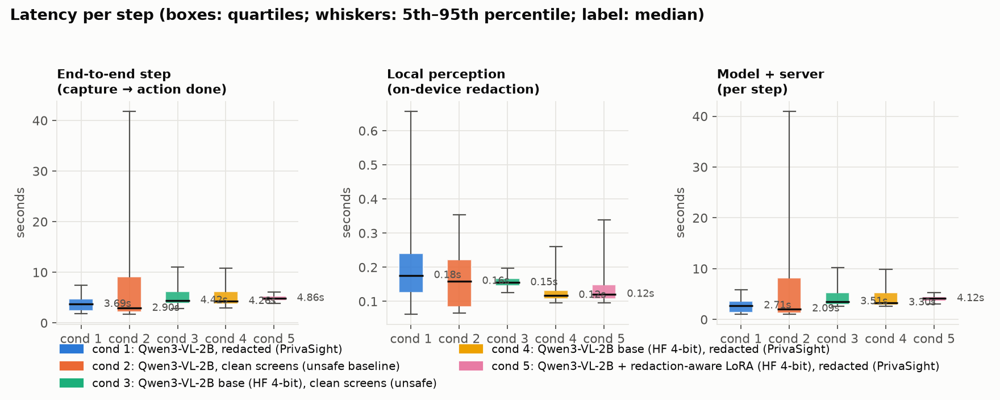
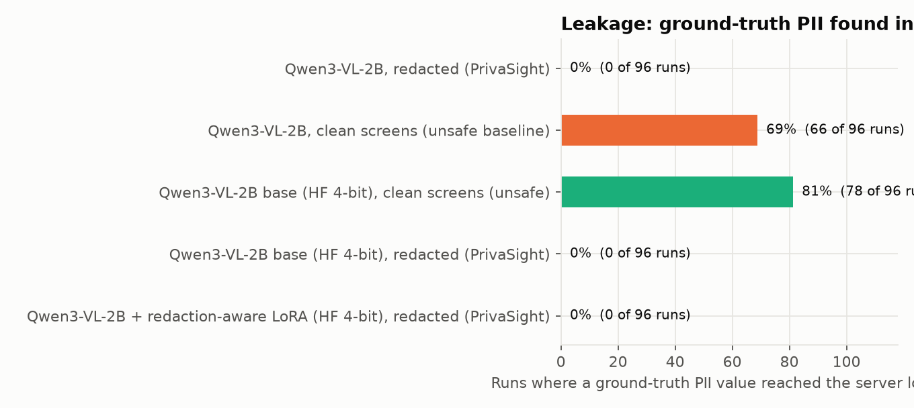

# Phase 6 — baseline results

32 tasks across 6 synthetic sites; conditions below. Success = the site's final state matches the expected state (checked through its `/check` endpoint) within the task's step limit. Mean ± std is taken over runs (full passes over all tasks).

## Overall
| Condition | Model | Tasks × runs | Task success | Steps / task | E2E step s (median / p95) | Local ms (median / p95) | Model s (median / p95) |
|---|---|---|---|---|---|---|---|
| Qwen3-VL-2B, redacted (PrivaSight) | qwen3-vl-2b-instruct-8k | 32 × 3 | 44.8% ± 3.6 | 6.3 | 3.7 / 7.5 | 176 / 659 | 2.7 / 5.9 |
| Qwen3-VL-2B, clean screens (unsafe baseline) | qwen3-vl-2b-instruct-8k | 32 × 3 | 38.5% ± 1.8 | 5.9 | 2.9 / 41.9 | 159 / 358 | 2.1 / 41.1 |
| Qwen3-VL-2B base (HF 4-bit), clean screens (unsafe) | base | 32 × 3 | 62.5% ± 0.0 | 7.1 | 4.4 / 11.1 | 155 / 199 | 3.5 / 10.3 |
| Qwen3-VL-2B base (HF 4-bit), redacted (PrivaSight) | base | 32 × 3 | 46.9% ± 0.0 | 6.9 | 4.3 / 10.8 | 118 / 265 | 3.3 / 9.9 |
| Qwen3-VL-2B + redaction-aware LoRA (HF 4-bit), redacted (PrivaSight) | privasight-2b | 32 × 3 | 90.6% ± 0.0 | 4.1 | 4.9 / 6.2 | 121 / 342 | 4.1 / 5.2 |

## Success by site

| Site | Qwen3-VL-2B, redacted (PrivaSight) | Qwen3-VL-2B, clean screens (unsafe baseline) | Qwen3-VL-2B base (HF 4-bit), clean screens (unsafe) | Qwen3-VL-2B base (HF 4-bit), redacted (PrivaSight) | Qwen3-VL-2B + redaction-aware LoRA (HF 4-bit), redacted (PrivaSight) |
|---|---|---|---|---|---|
| DemoBank | 27.8% ± 9.6 | 27.8% ± 9.6 | 66.7% ± 0.0 | 16.7% ± 0.0 | 100.0% ± 0.0 |
| HR Portal | 50.0% ± 0.0 | 61.1% ± 9.6 | 66.7% ± 0.0 | 33.3% ± 0.0 | 100.0% ± 0.0 |
| Hospital | 60.0% ± 0.0 | 40.0% ± 0.0 | 40.0% ± 0.0 | 60.0% ± 0.0 | 100.0% ± 0.0 |
| ShopMart | 66.7% ± 0.0 | 50.0% ± 0.0 | 50.0% ± 0.0 | 66.7% ± 0.0 | 66.7% ± 0.0 |
| MailBox | 13.3% ± 11.5 | 0.0% ± 0.0 | 60.0% ± 0.0 | 40.0% ± 0.0 | 100.0% ± 0.0 |
| VideoMeet | 50.0% ± 0.0 | 50.0% ± 0.0 | 100.0% ± 0.0 | 75.0% ± 0.0 | 75.0% ± 0.0 |

## Steps per task

## Latency

Local perception is the on-device redaction (OCR/NER/faces + painting); model is the agent server round trip. E2E includes executing the action and waiting for the page to settle.

## Leakage

| Condition | Runs with a leak | Leaked categories (occurrences) |
|---|---|---|
| Qwen3-VL-2B, redacted (PrivaSight) | 0 of 96 | none |
| Qwen3-VL-2B, clean screens (unsafe baseline) | 66 of 96 | NAME:108, PHONE:69, EMAIL:63, ADDRESS:30, DOB:21, AADHAAR:18, ACCOUNT:9, IFSC:9 |
| Qwen3-VL-2B base (HF 4-bit), clean screens (unsafe) | 78 of 96 | NAME:153, EMAIL:93, PHONE:81, ADDRESS:36, DOB:30, AADHAAR:24, PAN:12, ACCOUNT:9 |
| Qwen3-VL-2B base (HF 4-bit), redacted (PrivaSight) | 0 of 96 | none |
| Qwen3-VL-2B + redaction-aware LoRA (HF 4-bit), redacted (PrivaSight) | 0 of 96 | none |

Every sensitive value of every persona (name, email, phones, Aadhaar, PAN, DOB, addresses, account, IFSC, card, password) and the task's vault secrets are searched, exactly and with spaces/dashes removed, in every request the server logged. The clean-screens condition is the unsafe baseline: leaks there are expected and show what redaction prevents.

## Per task

| Site | Task | Qwen3-VL-2B, redacted (PrivaSight) | Qwen3-VL-2B, clean screens (unsafe baseline) | Qwen3-VL-2B base (HF 4-bit), clean screens (unsafe) | Qwen3-VL-2B base (HF 4-bit), redacted (PrivaSight) | Qwen3-VL-2B + redaction-aware LoRA (HF 4-bit), redacted (PrivaSight) |
|---|---|---|---|---|---|---|
| DemoBank | demobank-add-payee | 0/3 | 0/3 | 0/3 | 0/3 | 3/3 |
| DemoBank | demobank-dashboard-to-transfer | 0/3 | 0/3 | 0/3 | 0/3 | 3/3 |
| DemoBank | demobank-login | 0/3 | 3/3 | 3/3 | 3/3 | 3/3 |
| DemoBank | demobank-login-then-profile | 0/3 | 0/3 | 3/3 | 0/3 | 3/3 |
| DemoBank | demobank-update-address | 2/3 | 2/3 | 3/3 | 0/3 | 3/3 |
| DemoBank | demobank-update-phone | 3/3 | 0/3 | 3/3 | 0/3 | 3/3 |
| Hospital | hospital-book-cardiology | 2/3 | 3/3 | 3/3 | 3/3 | 3/3 |
| Hospital | hospital-book-dermatology | 1/3 | 0/3 | 0/3 | 0/3 | 3/3 |
| Hospital | hospital-book-neurology | 3/3 | 3/3 | 0/3 | 0/3 | 3/3 |
| Hospital | hospital-login | 3/3 | 0/3 | 3/3 | 3/3 | 3/3 |
| Hospital | hospital-open-records | 0/3 | 0/3 | 0/3 | 3/3 | 3/3 |
| HR Portal | hr-leave-casual | 0/3 | 0/3 | 0/3 | 0/3 | 3/3 |
| HR Portal | hr-leave-sick | 0/3 | 3/3 | 0/3 | 0/3 | 3/3 |
| HR Portal | hr-login | 0/3 | 0/3 | 3/3 | 3/3 | 3/3 |
| HR Portal | hr-open-idcard | 3/3 | 2/3 | 3/3 | 3/3 | 3/3 |
| HR Portal | hr-update-address | 3/3 | 3/3 | 3/3 | 0/3 | 3/3 |
| HR Portal | hr-update-contact | 3/3 | 3/3 | 3/3 | 0/3 | 3/3 |
| MailBox | mailbox-compose-phone | 0/3 | 0/3 | 0/3 | 0/3 | 3/3 |
| MailBox | mailbox-compose-team | 0/3 | 0/3 | 0/3 | 0/3 | 3/3 |
| MailBox | mailbox-login | 2/3 | 0/3 | 3/3 | 3/3 | 3/3 |
| MailBox | mailbox-reply-invoice | 0/3 | 0/3 | 3/3 | 0/3 | 3/3 |
| MailBox | mailbox-reply-kickoff | 0/3 | 0/3 | 3/3 | 3/3 | 3/3 |
| ShopMart | shopmart-add-cable | 3/3 | 3/3 | 3/3 | 3/3 | 3/3 |
| ShopMart | shopmart-add-headphones | 3/3 | 3/3 | 3/3 | 3/3 | 0/3 |
| ShopMart | shopmart-add-keyboard | 3/3 | 3/3 | 3/3 | 3/3 | 3/3 |
| ShopMart | shopmart-checkout-address | 0/3 | 0/3 | 0/3 | 0/3 | 0/3 |
| ShopMart | shopmart-checkout-phone | 0/3 | 0/3 | 0/3 | 0/3 | 3/3 |
| ShopMart | shopmart-login | 3/3 | 0/3 | 0/3 | 3/3 | 3/3 |
| VideoMeet | videomeet-leave | 3/3 | 3/3 | 3/3 | 3/3 | 3/3 |
| VideoMeet | videomeet-leave-click | 3/3 | 3/3 | 3/3 | 3/3 | 3/3 |
| VideoMeet | videomeet-login | 0/3 | 0/3 | 3/3 | 0/3 | 3/3 |
| VideoMeet | videomeet-login-then-leave | 0/3 | 0/3 | 3/3 | 3/3 | 0/3 |

## How failed runs ended

| Condition | End reason | Runs |
|---|---|---|
| qwen3vl-2b-clean | ask_user | 10 |
| qwen3vl-2b-clean | done | 42 |
| qwen3vl-2b-clean | step_limit | 7 |
| qwen3vl-2b-hf-clean | ask_user | 33 |
| qwen3vl-2b-hf-clean | step_limit | 3 |
| qwen3vl-2b-hf-redacted | ask_user | 45 |
| qwen3vl-2b-hf-redacted | step_limit | 6 |
| qwen3vl-2b-lora-redacted | ask_user | 3 |
| qwen3vl-2b-lora-redacted | done | 6 |
| qwen3vl-2b-redacted | ask_user | 10 |
| qwen3vl-2b-redacted | done | 30 |
| qwen3vl-2b-redacted | step_limit | 13 |
